# Supply Chain & Inventory Analytics: Larkspur Home Textiles

**Python (pandas, scikit-learn, SciPy) · SQL (SQLite) · inventory policy (ABC-XYZ, safety stock, reorder points) · OTIF and carrier analysis · profit-leak waterfall · Excel reorder template · Power BI (DAX)**

Larkspur Home Textiles (fictional) weaves and stitches bed sheets, duvet covers, towels, bathrobes, curtains and kitchen
linen, and ships them to 90 retailers in the USA, UK, EU, the Gulf and at home. Operations want to know **why
deliveries are late, why the best sellers run out while slow lines pile up, what one reorder rule for every SKU costs,
and where the margin leaks between the gross margin and the bottom line**.

**Summary page:** [`site/index.html`](site/index.html)

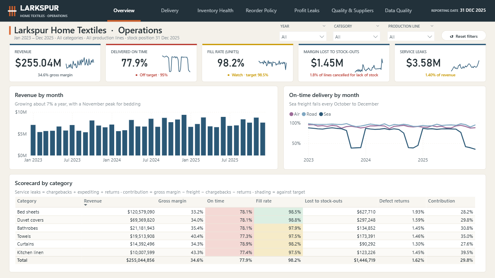

> **About the data.** The dataset is **synthetic**: 150 SKUs, 90 customers and 69,471 order lines over Jan 2023 – Dec 2025,
> produced by a documented generator ([`scripts/generate_data.py`](scripts/generate_data.py)). Stock-outs are not drawn at
> random: a **week-by-week inventory simulation runs the company's reorder rule**, so backorders, cancelled lines and
> expediting come out of the operation itself. Transit times follow known effects (carrier, route, customs, peak-season
> congestion), defects follow known production-line rates, and the ERP extracts contain the problems real ones have
> (two date formats, hand-typed ship modes, duplicates, credit notes booked as negative lines, missing proofs of delivery).
> Because the generator records the truth ([`data_raw/true_effects.json`](data_raw/true_effects.json)), every cleaning
> step and estimate is **checked against it**.

## Key results

| | Result | So what |
|---|---|---|
| 1 | **$255.0M revenue over three years at a 34.6% gross margin, but only 77.9% of lines arrive on time (OTIF 75.1% of units)** against a 95% target. 1.8% of order lines were cancelled for lack of stock ($4.0M of revenue). | Service, not sales, is the problem. |
| 2 | **Meridian Freight, the cheapest sea carrier ($0.29/kg vs $0.36), is on time for only 50% of lines** (Blue Anchor 84%). It saves about $59k a year in freight but its lines draw **$183k a year in late chargebacks**; with Blue Anchor's transit times they would draw $55k. | Cheapest freight is the most expensive. |
| 3 | **Sea freight is on time 87% of the year but only 40% from October to December**: port congestion adds 3.5 days and the quotes ignore it. | Quote longer for peak season. |
| 4 | **Fixing those two would lift on time from 77.9% to 94.7%** (with no line waiting for stock). Waiting for stock explains only 11% of late lines: the stock problem shows up as lost sales instead. | Two transport decisions close most of the gap. |
| 5 | **One reorder rule (6 weeks of demand) for every SKU fails the long-lead line: L4 (7-week lead time) is short of stock in 27% of weeks and loses 9.3% of its demand**, while L1 (3 weeks) sits on 5.7 weeks of cover. L4's yarn supplier also delivers a third of its orders two weeks late. | The rule ignores lead time. |
| 6 | **Recommended reorder points (lead-time demand + safety stock by ABC-XYZ class), set on 2023-24 and replayed on 2025 with the same demand and supplier delays: fill rate 98.07% → 99.41%, L4 89.8% → 98.9%, $351k of margin no longer lost** for $355k more average stock ($78k a year to carry): **about $273k a year better**. The replay of the current rule reproduces the actual 2025 fill rate (98.07% vs 97.81%). | Move stock from short to long lead times. |
| 7 | **Line L3's defect returns are 3.55% of shipped lines, four times the others (~0.9%)**: shade matching and stitching. Returns cost $0.90M in 2025. | A quality fix with a clear owner. |
| 8 | **The mezzanine store's stock records are 88% accurate vs 99% in the fast-pick zone** (cycle counts within ±2%). | Count the mezzanine more often. |
| 9 | **2025: avoidable leaks of $1.62M (1.8% of revenue)**: returns $0.90M, late chargebacks $0.37M, obsolete stock of discontinued lines $0.21M, expediting $0.13M; plus $1.08M carrying cost and **$0.73M margin lost to stock-outs, up from $0.31M in 2023** as demand outgrows the reorder rule. | Where the margin goes. |

## Approach

| Step | Script | What it does |
|---|---|---|
| 1 | [`generate_data.py`](scripts/generate_data.py) | Synthetic SKUs, customers, weekly demand (seasonal, growing 7% a year), a weekly inventory simulation of the current reorder rule (backorders, cancellations, production orders with supplier delays), transit times, returns and cycle counts, plus extract problems |
| 2 | [`clean.py`](scripts/clean.py) | Cleans the extracts into SQLite (`larkspur.db`): every fix logged in `dq_log` and **asserted** against the number injected (11 of 11 match) |
| 3 | [`sql/analysis.sql`](sql/analysis.sql) | Ten operations questions in SQL: OTIF, carriers, late causes, peak season, markets, stock-outs by line, supplier delays, contribution by category, defects, record accuracy. Results: [`sql/results.md`](sql/results.md) |
| 4 | [`delivery.py`](scripts/delivery.py) | Transit-time model (linear regression on carrier, market, peak season); coefficients checked against the true effects; what-ifs on every delivered line |
| 5 | [`inventory.py`](scripts/inventory.py) | ABC (revenue) × XYZ (demand variability) classes; recommended reorder points; 2025 replay of both rules with common random numbers for supplier delays |
| 6 | [`leaks.py`](scripts/leaks.py) | Profit-leak waterfall by year, from gross margin to contribution |
| 7 | [`excel_template.py`](scripts/excel_template.py) | Excel reorder-alert template with live formulas (below) |
| 8 | [`export_powerbi.py`](scripts/export_powerbi.py), [`build_pbip.py`](scripts/build_pbip.py) | Star schema for Power BI and the dashboard as a Power BI Project |

### Data quality

| Problem in the extract | Rows | Injected | Fix |
|---|---:|---:|---|
| Exact duplicate lines (re-run export) | 350 | 350 | removed |
| Test lines from the ERP go-live | 15 | 15 | removed |
| Credit notes booked as negative order lines | 120 | 120 | moved to `credit_notes` |
| Order date as dd/mm/yyyy (Gulf customers' EDI feed) | 6,120 | 6,120 | parsed with the EDI format |
| Ship mode typed by hand (SEA, Ocean, Truck, ...) | 1,800 | 1,800 | mapped to Sea / Air / Road |
| Customer id with stray case or spaces | 600 | 600 | trimmed, upper-cased |
| Free samples at zero price | 200 | 200 | kept, flagged, no revenue |
| Delivered, proof of delivery missing | 900 | 900 | kept, left out of on-time rates |
| Category spelled three ways in the SKU master | 8 | 8 | mapped |
| Unit cost missing for new SKUs | 3 | 3 | category cost ratio × list price, flagged |
| Cycle count keyed in but not finished | 40 | 40 | removed |

## Delivery: what makes lines late

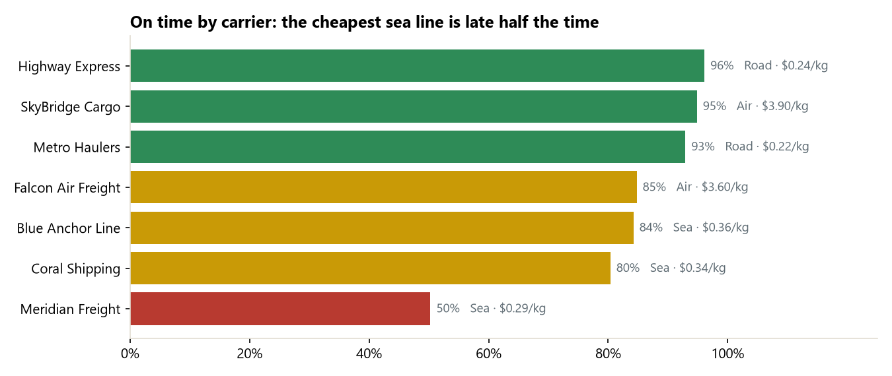

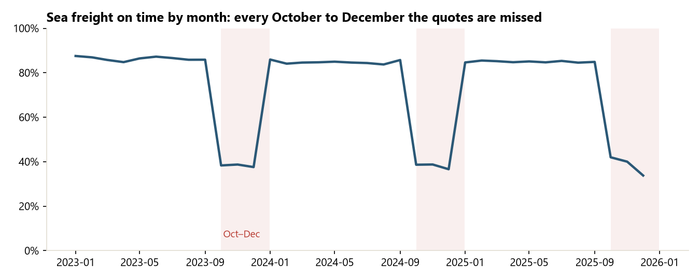

A linear model of sea transit days (R² 0.83) recovers every true effect within 0.05 days:

| Extra sea transit days | Estimated | True |
|---|---:|---:|
| Meridian Freight vs Blue Anchor | +3.02 | +3.0 |
| Coral Shipping vs Blue Anchor | +0.51 | +0.5 |
| October-December departure | +3.49 | +3.5 |
| EU vs USA (route + customs) | −4.40 | −4.4 |
| GCC vs USA (route + customs) | −11.99 | −12.0 |

| What if… | On time |
|---|---:|
| Today | 77.9% |
| Meridian's sea volume moved to Blue Anchor | 85.6% |
| October-December sea quotes include the congestion allowance | 86.3% |
| No line waits for stock | 79.6% |
| All three | **94.7%** |

## Inventory: one rule for every SKU

The current rule reorders at 6 weeks of demand (the 2022 average, never updated) for every SKU. The recommended rule:

> reorder point = average weekly demand × lead time + safety stock
> safety stock = z(service level) × √(lead time × demand SD² + demand² × lead-time SD²)

with service levels by class (A 98%, B 95%, C 90%; erratic Z items 2 points lower) and the lead time including each
line's average receipt delay. Everything is estimated on 2023-24 and tested on 2025.

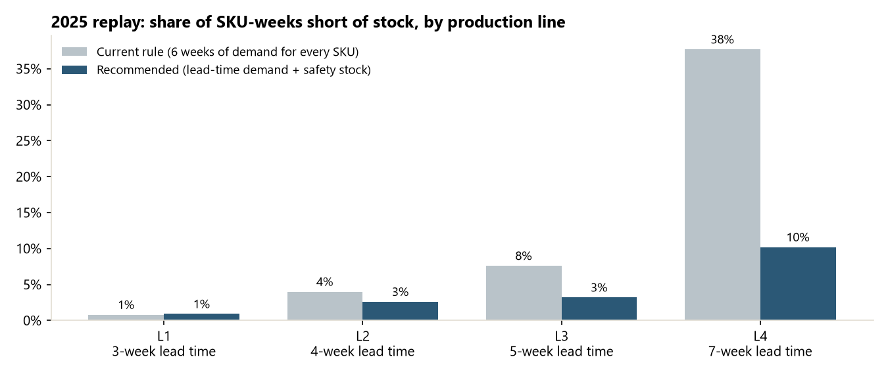

| 2025 replay | Current rule | Recommended |
|---|---:|---:|
| Fill rate (units) | 98.07% | **99.41%** |
| SKU-weeks short of stock | 10.0% | 3.6% |
| Margin lost to stock-outs | $591k | $240k |
| Average stock value | $4.51M | $4.87M |
| Carrying cost (22% a year) | $993k | $1,071k |

## Profit leaks

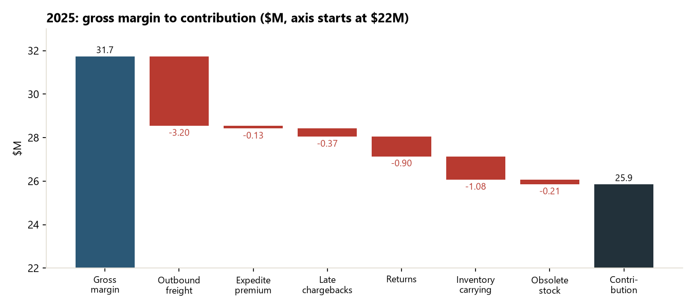

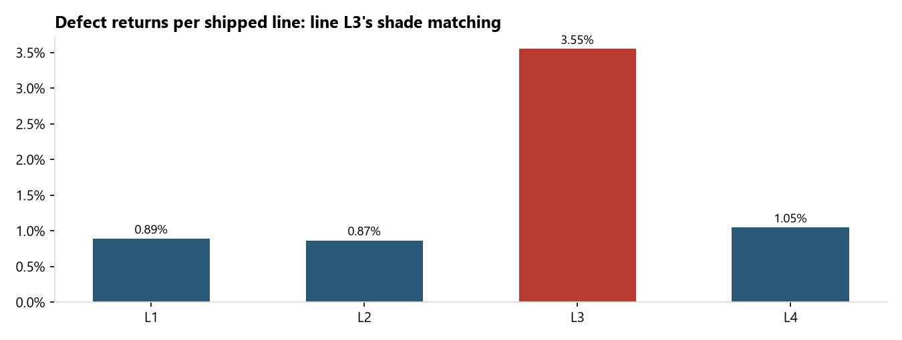

## Excel reorder-alert template

[`excel/Larkspur_reorder_alerts.xlsx`](excel/Larkspur_reorder_alerts.xlsx): one row per active SKU with stock on hand,
on order and backordered at 31 Dec 2025, and **live formulas** for service level, z, safety stock, reorder point,
inventory position, weeks of cover, status (REORDER NOW / WATCH / OK) and suggested order. Service levels, the watch
band and order cover sit on a Settings sheet (named ranges), so a planner can change a target or paste next week's stock
and every alert recalculates. Conditional formatting colours the status and draws data bars on weeks of cover; the
Summary sheet counts alerts by status and production line (COUNTIFS, SUMIF, SUMPRODUCT on the Excel table).

At 31 Dec 2025: **26 SKUs to reorder now ($2.04M of orders), 12 of them on line L4**. Recalculated in Excel with 0 errors;
one row checked by hand.

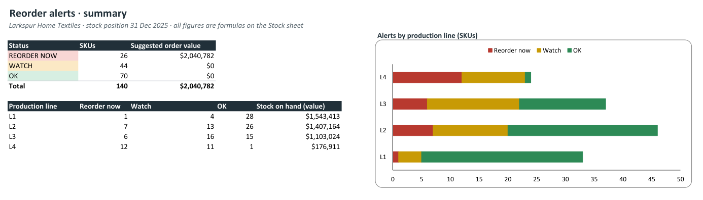

## Power BI dashboard

Seven pages in a light **"Mill floor"** industrial design made for this company: a greige canvas (the colour of
undyed cotton), white cards, industrial steel-blue data, a charcoal top navigation band and a thread-orange accent used
only for navigation. KPI tiles carry a status-coloured top edge (green / amber / red against operating targets), DIN-style
numbers and a monthly trend line; synced Year / Category / Production line filters sit beside the page title with a
one-click reset; an SKU tooltip and an **SKU Detail** drill-through. Larkspur is fictional, so the palette is a proposed
identity, not an official brand. Details: [`powerbi/DESIGN.md`](powerbi/DESIGN.md).

| Overview | Delivery |
|---|---|
|  | 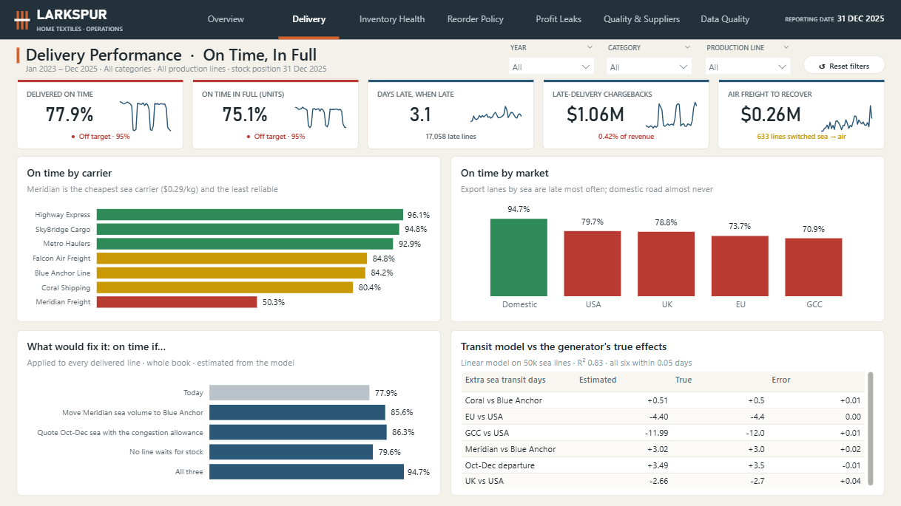 |
| **Inventory Health** | **Reorder Policy** |
| 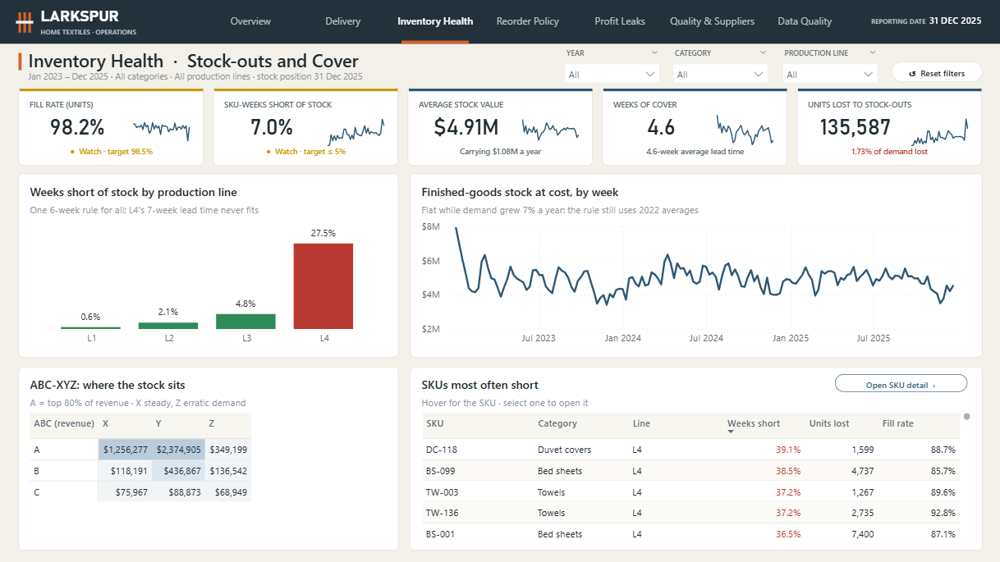 | 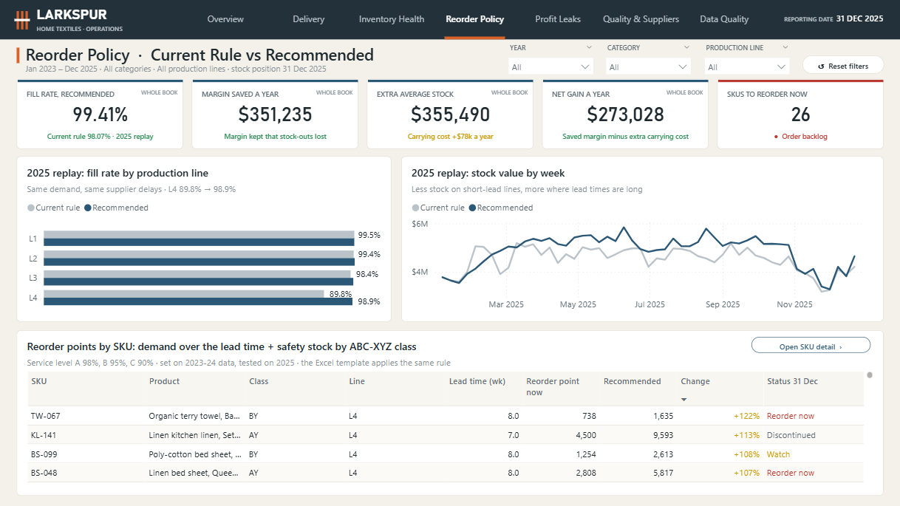 |
| **Profit Leaks** | **Quality & Suppliers** |
| 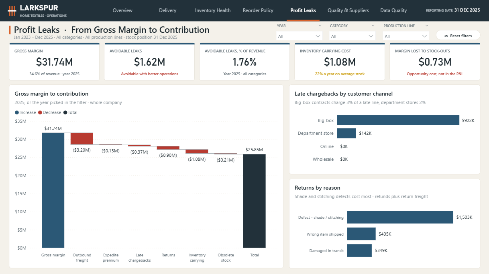 | 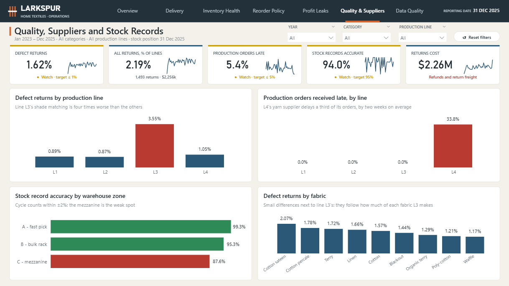 |
| **Data Quality** | **SKU Detail** (drill-through) |
| 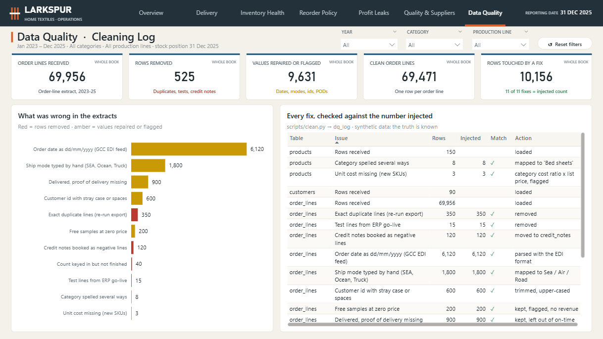 | 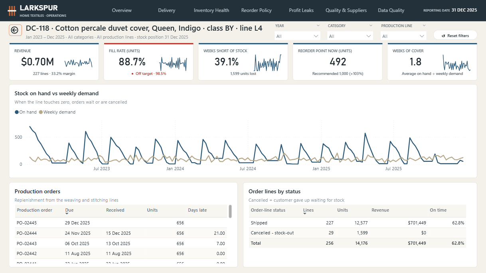 |

* **Model:** star schema: SKU, customer, week and carrier dimensions around order lines (69,471), weekly inventory
  (23,400), returns, cycle counts and production orders; policy, leak and data-quality result tables; 155 measures.
  Totals match SQL and Python exactly ($255,044,856 revenue, 77.9% on time, 11 of 11 cleaning checks).
* Saved as a **Power BI Project** ([`powerbi/Larkspur.pbip`](powerbi/Larkspur.pbip)) generated by
  [`scripts/build_pbip.py`](scripts/build_pbip.py).

## How to run

```bash
pip install pandas numpy scipy scikit-learn matplotlib openpyxl tabulate
python scripts/generate_data.py     # synthetic raw files -> data_raw/   (~10 s, seeded)
python scripts/clean.py             # -> data_clean/larkspur.db
python scripts/run_sql.py           # -> sql/results.md
python scripts/delivery.py          # transit model + what-ifs
python scripts/inventory.py         # ABC-XYZ, reorder points, 2025 replay
python scripts/leaks.py             # profit-leak waterfall
python scripts/excel_template.py    # -> excel/Larkspur_reorder_alerts.xlsx
python scripts/export_powerbi.py    # Power BI tables + findings
python scripts/make_charts.py       # README charts
python scripts/build_pbip.py        # Power BI project -> powerbi/Larkspur.pbip
```
The SQLite database is not committed; the scripts recreate it exactly.

## Tools
Python (pandas, NumPy, SciPy, scikit-learn) · SQL (SQLite: CTEs, joins, correlated subqueries) · operations analytics
(OTIF, ABC-XYZ, safety stock and reorder points, simulation backtest, cost-to-serve) · Excel (openpyxl: formulas, named
ranges, tables, conditional formatting, charts) · Power BI (DAX, Power Query, PBIP/TMDL)
